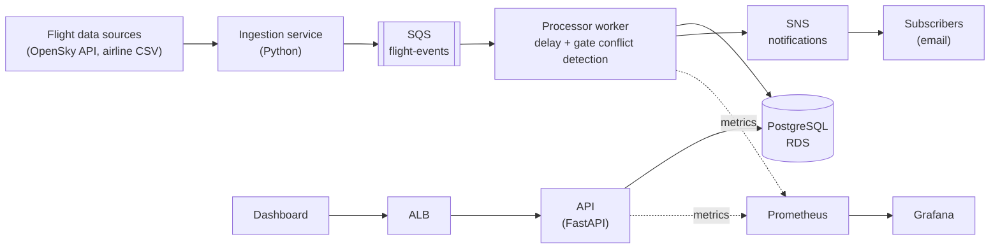

# AeroOps

Airport flight operations platform: a single source of truth for flight status, gate assignments and delay notifications.

> **Status:** Early development. Tracked on the project board (GitHub Projects).

## 1. Problem and scope

### Users

| User | Need |
|---|---|
| Operations controller (AOCC) | One view of flights, gates and delays; early warning on gate conflicts |
| Gate agent | Current status of the assigned gate and upcoming flights |
| Passenger | Timely notification of delays and gate changes |

### Problems addressed

- **Fragmented data.** Schedules, gate assignments and live status live in separate systems, so nobody has the full picture.
- **Manual gate planning.** Double-booked gates are found late, usually on the apron.
- **Late passenger communication.** Notifications depend on manual updates.
- **Low operational visibility.** Failures are discovered by users, not by monitoring.

### In scope

- Ingest flight data from external sources (OpenSky API, airline CSV feeds) and normalise it.
- Detect delays and gate conflicts asynchronously.
- Expose flights and gates through a REST API and a simple dashboard.
- Notify subscribers of delays and gate changes.
- Run on AWS, provisioned with Terraform, deployed as containers on Kubernetes.
- Define SLIs/SLOs, alerting and runbooks.

### Out of scope

Real passenger PII, ticketing, baggage handling, air traffic control.

### Architecture



The C4 diagrams and decision records will live in [`docs/`](docs/).

## 2. Technology stack

| Area | Choice | Rationale |
|---|---|---|
| Application | Python, FastAPI, PostgreSQL | Fast to build, typed, auto-generated API docs |
| Containers | Docker, docker-compose | Reproducible local and CI environments |
| Infrastructure as code | Terraform | Declarative, reviewable AWS infrastructure |
| Orchestration | Kubernetes (kind locally, EKS on AWS) | Standard deployment target; EKS is torn down when not in use to control cost |
| AWS services | VPC, ECR, RDS, SQS, SNS, ALB, IAM, CloudWatch | Managed services for networking, data, messaging and logging |
| CI/CD | GitHub Actions | Tests, image builds, `terraform plan` on pull requests |
| Architecture practice | C4 model, ADRs, Mermaid, AWS Well-Architected, Archify | Documented decisions and diagrams verified against the code |
| Reliability practice | Prometheus, Grafana, SLI/SLO, runbooks, postmortems, k6 | Measurable reliability and incident handling |
| Cost control | AWS Budgets alarm, `terraform destroy` after sessions | Prevents forgotten resources |

Significant choices are recorded as [Architecture Decision Records](docs/adr/).

## 3. Delivery plan

Work is tracked as GitHub Issues on a GitHub Project board, grouped into weekly milestones. Every change goes through a branch and pull request linked to an issue.

| Milestone | Focus | Outcome |
|---|---|---|
| M1 | Foundation and core API | Flights and gates API with tests and PostgreSQL |
| M2 | Containerisation | Dockerfile, docker-compose, CI build |
| M3 | AWS infrastructure | Terraform: VPC, ECR, RDS, IAM; cost alarm |
| M4 | Kubernetes | Deployments, services, config, probes; deployed to EKS |
| M5 | Event-driven processing | SQS ingestion, processor worker, SNS notifications |
| M6 | Reliability and documentation | SLOs, dashboards, alerts, load test, runbooks, architecture review |

## Repository layout

```
docs/        Architecture documentation and decision records
  adr/       Architecture Decision Records
```

Application code, infrastructure and Kubernetes manifests are added per milestone.

## License

MIT
